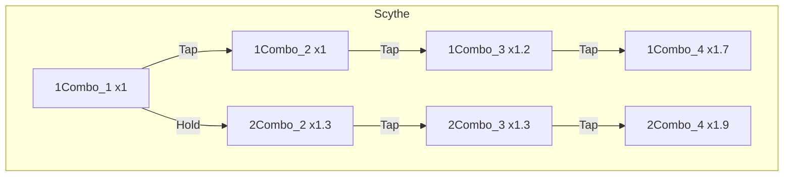
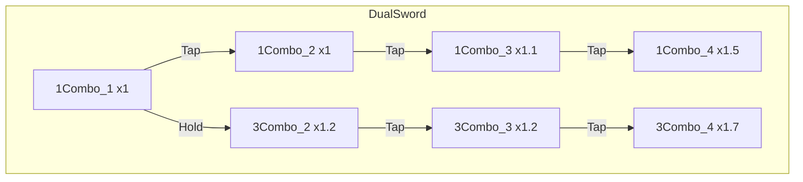

# Armas Fab (Lanza, Guadaña, Espadas Dobles) — Guía

Estado: assets y C++ creados. **Nada de esto se ha probado en PIE.** Todo lo marcado como "estimado" hay que ajustarlo a ojo.

## Resumen de assets

| Arma | DataAsset | BP | Malla | Montajes | Socket mano |
|---|---|---|---|---|---|
| Lanza | `DA_Spear` | `BP_Spear` (hijo de `BP_Sword_Katana`) | `Content/Models/Weapons/Spear/SM_Spear` | `Montages/Animations/Manny/Spear/` (26) | `RightHandSpear` |
| Guadaña | `DA_Scythe` | `BP_Scythe` (copia de `BP_Spear`) | `Content/Models/Weapons/Scythe/SM_Scythe` | `Montages/Animations/Manny/Scythe/` (26) | `RightHandScythe` |
| Espadas dobles | `DA_DualSword` | `BP_DualSword` (copia de `BP_Base_Sword`, reparentado a `ADualSword`) | `Content/Models/Weapons/DualSword/SM_DualSword` | `Montages/Animations/Manny/DualSword/` (22) | `RightHandDualSword` + `LeftHandSword` |

DataAssets en `Content/Blueprints/DataAssets/Items/Weapons/`, BPs en `Content/Blueprints/Items/Weapons/`.

Tags nuevas (`Config/DefaultGameplayTags.ini`): `Weapon.Melee.{Spear,Scythe,DualSword}` y `Holster.Melee.{Spear,Scythe,DualSword}`.

## Esqueleto y animaciones

- Los packs de Fab traen su propio `SK_Mannequin` (otra ruta). Se añadieron como **esqueletos compatibles** en `SK_Mannequin` del proyecto (Spear, Scythe y Dual_Sword `Sequence2`).
- Dual Swords: se eligió `Animations/Sequence2` porque usa el `SK_Mannequin` UE5; `Sequence1` usa el esqueleto UE4.
- Las secuencias de Fab usadas por los montajes tienen **`enable_root_motion` activado** (modificado en `Content/Fab/`, no en copias). Algunas se desplazan mucho (skill de Scythe ≈ 12 m, `Combo_Attack_05_04` de Spear ≈ 8 m).

### Sockets en `SK_Mannequin` (proyecto)

| Socket | Hueso | Origen |
|---|---|---|
| `RightHandSpear` | `hand_r` | Transformada de `Weapon_Actor_R` del esqueleto Fab de Spear |
| `RightHandScythe` | `hand_r` | Transformada de `Scythe_Weapon_R` del esqueleto Fab de Scythe |
| `BackScytheSocket` | `spine_05` | Transformada de `Scythe_Holder` (aún sin uso, ver pendientes) |
| `RightHandDualSword` | `hand_r` | Transformada de `Weapon_R` (Fab Dual) |
| `LeftHandSword` | `hand_l` | Transformada de `Weapon_L` (Fab Dual) |
| `LeftClavicleSocket` | `clavicle_out_l` | **Estimado**: espejo de `RightClavicleSocket` |

Mallas del proyecto: `SM_Spear` y `SM_Scythe` llevan un socket `LeftHandIK` (estimado: 45 cm en +Y y -35 cm en Y respectivamente).

## Montajes

Se crearon desde las secuencias individuales (no `_All`), con `DefaultSlot`, blend 0.15 / 0.10.

Notifies por montaje: `MotionWarping` (SkewWarp, target `Facing`, rotación `FACING`, igual que Katana), `ANS_SwordCollision`, `ANS_ComboWindow`. Los de aire, launch y skill llevan además `ANS_SetDamageType`.

- **Colisión**: se detecta automáticamente como la región contigua alrededor del pico de velocidad de `hand_r` (y `hand_l` en dual), con umbral 35 %. Es una aproximación: revisar en el editor.
- **Ventana de combo**: empieza al terminar la colisión y llega hasta ~85 % del montaje. Es más larga que en Katana (~0.4 s).
- **Tipo de daño**: aire → `Damage.FromAir`; `Attack_Up` → `Damage.Launch`; skill de Spear → `Damage.Puncture` (cue `Puncture`); skill de Scythe/Dual → `Damage.Slash` (cue por defecto, no existe cue `Slash`). Sin esto los enemigos no quedan suspendidos en el aire (`GA_HitReact` decide por el tag).
- No se usaron `Air_to_Floor`, `Start/Loop/End`, `Buff`, ni `Attack_Speed`/`Dash_Air_Attack` (el sistema de combos no soporta secuencias en tres partes).

## Árboles de combo

Daño base: Spear 19, Scythe 26, Dual 10 (Katana 15, GreatSword 30). Los multiplicadores son estimados.

| | Aire (Tap en cadena, ×1.1…×1.4) | Launch | Skill | Knockback |
|---|---|---|---|---|
| Spear | `Jump_Attack_Combo_1..4` | `Attack_Up` ×0.6 | `Skill_02` ×2.0 | 35 cm / 0.15 s |
| Scythe | `Jump_Attack_Combo_1..4` | `Attack_Up` ×0.6 | `Skill_01` ×2.2 | 45 cm / 0.15 s |
| Dual | `Jump_Attack_Combo_1..4` | `Attack_Up` ×0.6 | `Skill` (`Combo_Attack_05_02`) ×2.0 | 25 cm / 0.15 s |

Los montajes `3Combo`–`5Combo` de Spear y Scythe, y `2Combo`/`5Combo` de Dual, están creados pero **no enlazados** (disponibles para upgrades). No se definieron `ComboUpgrades`.

## Cambios de C++

| Archivo | Cambio | Motivo |
|---|---|---|
| `Sword.cpp` | `return` → `continue` en el loop de hits cuando el actor está en `IgnoreActors` | El `return` cortaba el golpe y los demás enemigos del arco no recibían daño |
| `Sword.h/.cpp` | Propiedad `TraceHalfExtent` (default `(20,20,20)`) | Lanza y guadaña necesitan otro tamaño de trace sin cambiar Katana/GreatSword |
| `Sword.h/.cpp` | `OnBoxOverlap` delega en `TraceAndApplyHits(...)`; caja y trace points pasan a `protected`; `ClearIgnoreActors`/`SetWeaponCollisionEnabled` públicos | Reutilizar la lógica de daño desde `ADualSword` |
| `DualSword.h/.cpp` | `ADualSword : ASword`: segunda malla y hitbox (mano izquierda), `OffHandSocketName` (`LeftHandSword`), `OffHandHolsterSocketName` (`LeftClavicleSocket`), `SetActiveHand`, comparte el material dinámico de `ItemMesh` (la disolución afecta a ambas), `IgnoreActors` compartido (sin doble daño) | Soportar dos espadas |
| `AnimNotifyState_DualSwordHand.h/.cpp` | Notify `Dual Sword Hand` (`Both`/`Right`/`Left`) | Elegir la mano activa sin tocar `ANS_SwordCollision` |

### Combate aéreo (juggle, estilo DMC5)

- `AEntity::StartJuggle(Duration)` / `EndJuggle()` / `IsJuggled()` (`Entity.h/.cpp`): mientras dura, gravedad 0, velocidad 0 y movimiento `Falling` (un timer corrige `MOVE_None`/`MOVE_Flying`). Cada llamada reinicia el tiempo (`DefaultJuggleDuration`, 2 s). Al terminar restaura la gravedad y cae.
- `ASword::ApplyJuggle` (`Sword.cpp`): tras un golpe con `Damage.Launch` o `Damage.FromAir`, suspende al enemigo (si es lanzable y el golpe es launch o ya está en el aire) y al jugador si está en el aire. Aplica a todas las armas.
- Probado por el usuario con Katana: funciona.

Valores de los montajes de Dual: la mano activa (`Hand`) se infiere por velocidad de `hand_r` vs `hand_l` (umbral 1.4×). Casi todos salieron `Both`; `2Combo_4` salió `Left`, `3Combo_3` y `3Combo_4` `Right`. Revisar a ojo.

## Problemas conocidos / pendientes

- **Nada probado en PIE** (agarre, hitboxes, timing, feel).
- Funda: `AWeapon::Holster` usa `RightClavicleSocket` fijo. La guadaña mide > 1 m y debería ir a `BackScytheSocket`; hace falta un socket de funda configurable en el DataAsset (cambio de C++ no hecho). `LeftClavicleSocket` es una suposición.
- `LeftHandIK` de lanza y guadaña, e hitbox/trace de las tres armas: valores estimados por tamaño de malla.
- Warp: no se creó ningún target `Facing` nuevo; se asume el que ya registran Katana/GreatSword.
- `ANS_RotationRootMotion` aparece roto en los montajes de Katana (su clase no existe) y no se añadió.
- El root motion de algunas animaciones es muy grande.
- Las ventanas de combo son largas y la detección de colisión puede fallar en animaciones con giros.
- Sin pruebas de regresión de Katana, GreatSword ni enemigos con espada tras el refactor de `ASword`.
- Sin prueba de enemigo usando las armas nuevas.

## Pasos manuales sugeridos

1. Equipar cada arma y revisar agarre, `LeftHandIK` y hitbox (en los BPs, ajustar `Weapon Box` y los trace points).
2. Probar combos de suelo, aire, launch y skill; recortar ventanas de combo si son demasiado permisivas.
3. Verificar que los enemigos quedan suspendidos con los golpes aéreos.
4. Probar Katana y GreatSword (regresión del refactor).
5. Colocar `BP_Spear`/`BP_Scythe`/`BP_DualSword` en el `ChildActorComponent` de un enemigo de prueba.
