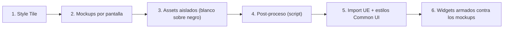

# VELMARA — Kit de producción UI/UX (prompts para IA generadora + handoff a Common UI)

> Proyecto: Velmara (UE 5.5, Common UI). Dark fantasy gótico con toques vampíricos.
> Dirección: minimalista elegante (Phantom Blade Zero) con la claridad de lectura de God of War (2018).
> Los prompts están en **inglés** a propósito: GPT Image y Nano Banana siguen mejor las instrucciones técnicas en inglés.

---

## 0. Recomendación de modelo (Tripo)

| Uso | Modelo | Por qué |
|---|---|---|
| **Assets aislados** (marcos, ornamentos, iconos, máscaras) | **GPT Image** | Sigue mejor las restricciones técnicas (plano, simétrico, sin ruido, márgenes). |
| **Mockups de pantalla** e iteraciones con imagen de referencia | **Nano Banana Pro** | Escribe mejor el texto y mantiene la coherencia entre pantallas cuando le pasás un mockup anterior como referencia. |
| Retoques ("sacale la textura del interior", "hacé las esquinas simétricas") | Nano Banana Pro | Edición sobre imagen existente. |

Si solo querés usar uno: **GPT Image para todo** funciona bien; Nano Banana Pro solo mejora los mockups.

---

## 1. La regla de oro (el problema del 9-slice)

**La textura nunca va en una zona que se estira.**

Un 9-slice estira los 4 bordes y el centro. Si la IA mete ruido, papel, grunge o degradado ahí, UE lo deforma. Por eso el kit separa todo en capas:

| Capa | Cómo se hace | ¿Lleva textura? |
|---|---|---|
| Relleno de paneles (negro translúcido) | **Procedural en UE** (Brush `Box`/`Rounded Box` con color + alpha, o material de degradado) | No |
| Marcos 9-slice | Imagen IA: **solo el contorno**, interior vacío, bordes rectos y lisos, detalle solo en esquinas. Se dibuja con `Draw As = Border` (no pinta el centro) | No |
| Ornamentos (esquinas, separadores, crests, marcadores) | Imagen IA, **tamaño fijo, nunca se estira** (`Draw As = Image`) | Puede, pero no hace falta |
| Grano/textura sutil (opcional) | Una textura **seamless tileable** aparte, aplicada por material con tiling a baja opacidad | Sí (se repite, no se estira) |
| Fondos de pantalla completa (menú, carga, muerte) | Imagen IA 16:9, escalado uniforme con `ScaleBox` | Sí |
| Mockups | Solo referencia visual. **Nunca se recortan para usar en el juego** | Sí |

### Por qué blanco sobre negro
Todos los assets se generan como **forma blanca pura sobre fondo negro puro**:
- Pedirle "fondo transparente" a la IA a veces devuelve un **damero pintado** (falso).
- Blanco/negro se convierte trivialmente en alpha (luminancia → alpha) con un script.
- En UE se tiñen con el `Tint` del brush, así **un solo asset sirve para Normal/Hover/Pressed/Disabled** en los `CommonButtonStyle`, y la paleta se puede ajustar sin regenerar imágenes.
- Si algo necesita dos colores (ej. borde hueso + diamante rojo), son **dos assets superpuestos**.

---

## 2. Design system (lo que la IA ensambladora debe respetar)

### 2.1 Paleta

| Token | Hex | Uso |
|---|---|---|
| `Void` | `#0A0809` | Fondo de paneles (alpha 70–85 %), overlays |
| `Charcoal` | `#1C1A1C` | Fondo de slots, tracks de barras |
| `Ash` | `#3A3638` | Líneas inactivas, deshabilitados |
| `Bone` | `#E8E0D0` | Texto principal, líneas activas, marcos |
| `BoneMuted` | `#A39C8E` | Texto secundario, descripciones |
| `Blood` | `#8E0F14` | Acento: hover/selección, vida |
| `BloodBright` | `#C21A1F` | Crítico, daño, focus de gamepad |
| `BloodDried` | `#4A0A0D` | Daño retrasado en barras, fondos de alerta |

Funcionales (baja saturación, uso puntual, para no romper la paleta de 3 colores):

| Token | Hex | Uso |
|---|---|---|
| `Shield` | `#B8C0C4` | Barra de escudo (plata fría) |
| `Spectral` | `#8F86A8` | Energía/posesión (violeta pálido fantasmal) |
| `Sunlight` | `#D9A441` | Solo para el aviso de exposición solar |

Opacidades: panel 80 %, overlay de pausa/modal 60 % + `BackgroundBlur`, texto deshabilitado 40 %.

### 2.2 Tipografía (Google Fonts, licencia OFL, editable y localizable en UE)

| Rol | Fuente | Notas |
|---|---|---|
| Títulos, botones, nombres de jefe, números del HUD | **Cinzel** (Regular/SemiBold) | Mayúsculas romanas, tracking amplio. Soporta acentos y ñ. |
| Cuerpo, diálogos, descripciones, tooltips | **EB Garamond** (Regular/Italic/SemiBold) | Serif clásica, legible en pantalla. Latín extendido, cirílico, griego. |
| Logo | `T_UI_Logo_Velmara` existente | Se mantiene. |

> Alternativa: ya tenés **Cardo** importada, que puede reemplazar a EB Garamond. Sea cual sea la fuente, **todo texto es `CommonTextBlock`, no va dentro de la imagen.** Esto permite localizar.

Escala a 1080p (con `FontDPI=72` → tamaño ≈ px):

| Estilo (`CommonTextStyle`) | Fuente | Tamaño | Letter spacing | Color |
|---|---|---|---|---|
| `TS_Display` (muerte, título) | Cinzel | 72 | 250 | Bone |
| `TS_H1` | Cinzel SemiBold | 48 | 200 | Bone |
| `TS_H2` | Cinzel | 32 | 150 | Bone |
| `TS_H3` / `TS_Button` | Cinzel | 24 | 120 | BoneMuted → Bone en hover |
| `TS_Body` / diálogo | EB Garamond | 24 | 0 | Bone |
| `TS_Subtitle` | EB Garamond | 32 (escalable desde Opciones) | 0 | Bone |
| `TS_Label` | Cinzel | 18 | 100 | BoneMuted |
| `TS_Caption` (mínimo absoluto) | EB Garamond | 16 | 0 | BoneMuted |
| `TS_BossName` | Cinzel | 28 | 300 | Bone |
| `TS_Speaker` | Cinzel SemiBold | 22 | 150 | BloodBright |

### 2.3 Grilla y medidas
- Grilla de **8 px**. Safe area: **64 px** desde los bordes de la pantalla.
- Líneas a 1080p: **1 px** (hairline) y **2 px** (énfasis). Los assets se producen a **2x** (2 px / 4 px).
- Esquinas: rectas o en punta (diamante/arco ojival). **Nada redondeado.**

### 2.4 Lenguaje de estados (botones, filas, slots)

| Estado | Visual |
|---|---|
| Normal | Texto `BoneMuted`, sin fondo |
| Hovered / Focused (gamepad) | Franja horizontal degradada `Blood` (0 → 70 % → 0 alpha) detrás + diamante marcador a la izquierda + texto `Bone` |
| Pressed | Franja `BloodBright` 85 % |
| Selected | Diamante relleno `BloodBright` permanente + subrayado hairline |
| Disabled | Texto `Ash` 40 %, sin marcador |

Animaciones: fade y slide de 8–16 px, 120–180 ms, ease-out. Nada de rebotes.

---

## 3. Flujo de producción



1. Generá **primero el Style Tile (prompt 00)**. Elegí el mejor resultado.
2. **Adjuntalo como imagen de referencia en TODOS los prompts siguientes** y agregá la línea de referencia (§4.3).
3. Mockups → elegís el que te convence → assets.
4. Generá **un marco 9-slice por imagen**. Los iconos y ornamentos van en hojas de **4–6 elementos máximo**, en grilla con mucho espacio entre ellos.

---

## 4. Bloques reutilizables (copiar/pegar)

Cada prompt final se arma así: **[STYLE] + [ASSET TECH o MOCKUP TECH] + [prompt específico]**.

### 4.1 `[STYLE]`
```
Visual style: AAA dark-fantasy action game UI for "Velmara", a gothic vampire world. Minimalist and elegant, in the restrained spirit of Phantom Blade Zero and the clean readability of God of War (2018) menus. Thin hairline strokes, generous negative space, translucent black panels that fade to transparent at their edges, sharp geometric accents: small diamonds, thin needle-like spikes, pointed gothic arches, subtle thorn motifs. Vampiric hints used sparingly: blood drops, crescent moons, bat-wing curves. Strict palette: void black #0A0809, charcoal #1C1A1C, ash #3A3638, bone white #E8E0D0, muted bone #A39C8E, blood red #8E0F14, bright blood #C21A1F. No other hues. No rounded corners, no cartoon look, no sci-fi, no fantasy clichés like gems or gold filigree.
```

### 4.2 `[ASSET TECH]` (para todo asset aislado)
```
Technical requirements (game-ready UI asset): pure white #FFFFFF shapes on a solid pure black #000000 background. Perfectly front-facing orthographic flat 2D, vector-like, crisp clean edges. Uniform line thickness. Absolutely no noise, no grain, no texture, no paper, no grunge, no scratches, no gradients unless explicitly requested, no bevel, no emboss, no drop shadow, no glow, no lighting, no 3D, no perspective, no colors other than white on black. Centered, with at least 10% empty black margin on every side. No text, no letters, no numbers, no runes that look like letters, no watermark, no signature, no frame around the canvas, no mockup scene.
```

### 4.3 Línea de referencia (cuando adjuntás el Style Tile)
```
Use the attached image as the strict style reference: match its line weight, ornament language, proportions and level of minimalism exactly.
```

### 4.4 `[MOCKUP TECH]`
```
Format: 16:9 landscape, representing a 1920x1080 in-game screenshot. The UI is the focus: rendered crisp and flat on top of the scene, aligned to an 8px grid, with consistent 64px safe margins from the screen edges. Typography: elegant high-contrast Roman capitals with wide letter-spacing for titles and buttons (like Cinzel), and a classic Garamond serif for body text (like EB Garamond). All UI text in Spanish. The scene behind is dark, desaturated and slightly out of focus so the UI reads clearly. Panels are translucent black, never opaque boxes. No watermark, no device frame, no extra logos.
```

---

## 5. Prompts

### 00 — Style Tile (generar primero)
**Modelo:** GPT Image · **Aspecto:** 16:9 · **Bloques:** [STYLE]
```
A UI style tile / design system sheet for a dark-fantasy gothic game, on a void black background, organized in a clean grid with lots of spacing. Include: (1) a row of 8 color swatches as flat squares: #0A0809, #1C1A1C, #3A3638, #E8E0D0, #A39C8E, #8E0F14, #C21A1F, #4A0A0D; (2) a typography sample: a large title "VELMARA" in widely spaced Roman capitals, a subtitle, and a paragraph in classic Garamond serif; (3) a vertical list of 5 menu buttons showing the states normal, hovered (soft horizontal blood-red gradient strip fading to transparent at both ends behind the text, with a small red diamond marker on the left), pressed, selected, disabled; (4) a translucent black panel framed only by four thin L-shaped corner brackets with tiny diamond tips; (5) a long thin health bar with tapered blade-like ends, blood red fill, a darker trailing damage segment, and a hairline silver shield bar above it; (6) a row of 5 small diamond pips, 3 filled with pale spectral violet; (7) a square inventory slot with hairline border and tiny corner notches, one normal and one selected; (8) a thin horizontal separator with a small diamond in the middle. Flat, crisp, minimalist, premium AAA feel.
```

### 5.1 Mockups (Nano Banana Pro · 16:9 · [STYLE] + [MOCKUP TECH] + ref. Style Tile)

**M01 — HUD de gameplay**
```
Third-person gothic action game screen: a cloaked vampire hunter seen from behind in a moonlit ruined cathedral. HUD with no background panels at all, floating directly over the scene. Top-left: a long thin health bar (about 420x8 px) with tapered blade-like ends, blood red fill at 70%, a darker dried-blood trailing segment showing recent damage; a hairline silver shield bar just above it; below it a row of 5 small diamond pips for spectral energy, 3 filled in pale violet. Bottom-left: 4 small diamond-shaped skill slots with white monochrome skill icons and tiny keyboard key hints below them, one slot on cooldown with a dark radial sweep. Bottom-right: blood currency counter, a small blood-drop icon and the number "1.250" in Roman capitals, plus a minimal weapon indicator showing a sword icon. An enemy in the mid-distance with a tiny thin red bar above its head and a minimal lock-on reticle made of four thin inward-pointing spikes around it. Lots of empty space; the HUD feels quiet and elegant.
```

**M02 — Pelea de jefe**
```
Boss fight screen: a towering corrupted paladin boss in a gothic arena lit by shafts of pale moonlight. Bottom-center: a long thin boss health bar about 1100 px wide with tapered ends, blood red fill, darker damage trail, a hairline silver shield layer, and three tiny diamond markers along it indicating phase thresholds. Above the bar, centered, a small elegant crest ornament (broken thorned halo with subtle bat-wing curves) and the boss name "EL PALADÍN CAÍDO" in widely spaced Roman capitals. Player vitals top-left, same minimal style as the HUD. The rest of the screen is clean.
```

**M03 — Interacción, notificación y subtítulos**
```
Exploration screen in a dark gothic crypt. Right of center, next to a rusted iron lever: an interaction prompt made of a small diamond-shaped outline holding a keyboard key "E", a thin circular hold-progress ring around it half filled in bone white, and the text "Accionar palanca" in Roman capitals beside it. Top-right: a notification sliding in, a horizontal black strip fading to transparent toward the left, with a small quill icon, the label "OBJETIVO ACTUALIZADO" in small red capitals and below it "Encuentra la cripta del Conde" in serif. Bottom-center: a single subtitle line in white serif text over a very soft dark gradient band, the speaker name "VELKAN" in small red capitals before the line.
```

**M04 — Cuadro de diálogo con opciones**
```
Dialogue scene: a pale aristocratic vampire NPC in a candlelit chamber, cinematic composition. The bottom third of the screen has a horizontal black gradient band (transparent at top, 80% black at bottom), no hard borders. Inside it on the left: speaker name "CONDESA ISOLDE" in red Roman capitals, a thin hairline separator with a tiny diamond, then two lines of dialogue in elegant serif. On the right side: a vertical list of three dialogue choices in serif; the second one is hovered with a soft blood-red gradient strip behind it and a small red diamond marker. Bottom-right corner: input hints "Ⓐ Elegir  Ⓑ Saltar" as small gamepad button icons with labels.
```

**M05 — Menú principal**
```
Main menu screen. Full-screen key art: a gothic cathedral silhouette under a huge blood moon, mist, a lone figure on the stairs; the left third of the image is darker to host the UI. Top-left: the game logo "VELMARA" in elegant spaced Roman capitals with a small crescent ornament. Left side, vertically centered: a list of menu options in Roman capitals: "CONTINUAR", "NUEVA PARTIDA", "CARGAR PARTIDA", "OPCIONES", "CRÉDITOS", "SALIR". "NUEVA PARTIDA" is hovered: a soft blood-red horizontal gradient strip behind the text fading to transparent on both ends, a small red diamond marker on its left, text in bright bone white; the others are muted bone. Bottom-right: input hints with gamepad button icons "Ⓐ Aceptar". Bottom-left: tiny version text.
```

**M06 — Menú de pausa**
```
Pause menu over a blurred, darkened gameplay frame (60% black overlay with background blur). Centered vertical composition: the title "PAUSA" in large spaced Roman capitals, a thin separator with a central diamond under it, then options: "REANUDAR", "INVENTARIO", "ÁRBOL DE ATRIBUTOS", "OPCIONES", "GUARDAR", "MENÚ PRINCIPAL". One option hovered with the blood-red gradient strip and diamond marker. Left side: a minimal panel with current objective in serif. Bottom-right: input hints "Ⓐ Aceptar  Ⓑ Volver".
```

**M07 — Opciones**
```
Settings screen over a dark blurred background. Top: a row of tabs in Roman capitals "JUEGO", "VIDEO", "AUDIO", "CONTROLES", "ACCESIBILIDAD" with small LB and RB gamepad icons at both ends; the active tab "AUDIO" is bone white with a thin red underline and a tiny diamond, the others are muted. Left two-thirds: a list of setting rows with label on the left and control on the right, separated by very faint hairlines: "Volumen general" with a thin hairline slider and a small diamond-shaped thumb, value "80"; "Música" slider; "Subtítulos" toggle shown as "NO / SÍ" with "SÍ" highlighted and underlined; "Tamaño de subtítulos" with left/right chevron arrows around the value "GRANDE"; "Idioma" dropdown with a small down chevron. One row is focused with the soft red gradient strip behind it. Right third: a description panel in serif text explaining the focused option, framed only by thin corner brackets. Bottom-right: input hints "Ⓐ Cambiar  Ⓑ Volver  Ⓧ Restablecer".
```

**M08 — Inventario / Equipo**
```
Inventory and equipment screen over a dark background. Left: a faint ghostly silhouette of the character with equipment slots around it (weapon, secondary weapon, relic, two consumables), each a small square slot with hairline border and tiny corner notches containing a white monochrome icon. Center: a grid of 6x4 square inventory slots, some filled with white monochrome weapon and item icons (sword, dual blades, flintlock pistol, spear, scythe, vials); one slot selected with a double hairline border, red inner corner brackets and a subtle red glow-free fill. Right: a tooltip panel framed by corner brackets: item name "ESPADA DEL OCASO" in Roman capitals, a separator, item type in small muted capitals, a short serif description, and stat rows with small icons and numbers, one stat showing a red increase arrow comparison. Top: tabs "EQUIPO" and "OBJETOS". Bottom-right: input hints.
```

**M09 — Árbol de atributos / Altar de sangre**
```
Attribute tree upgrade screen at a blood altar. Dark background with a faint large circular sigil watermark. Center: a constellation-like tree of diamond-shaped nodes connected by thin hairlines; three node states: locked (ash grey outline), available (bone white outline with a small pulse), purchased (filled blood red center with a bone outline); purchased paths use red lines, others ash grey. Each node holds a small white attribute icon. Right: a details panel framed by corner brackets: node name "SED INSACIABLE", serif description, effect line "+10% Daño base", and cost with a blood drop icon "350". Top-right: current blood currency counter. Bottom-right: input hints "Ⓐ Desbloquear  Ⓑ Volver".
```

**M10 — Pantalla de carga**
```
Loading screen: full-screen moody art of a gothic city at night with fog and a red moon, darker at the bottom. Bottom-left: a thin separator with a diamond, then a lore tip in serif text two lines long, preceded by the small label "CONSEJO" in red Roman capitals. Bottom-right: a small circular sigil loading spinner made of thin concentric rings and a crescent, in bone white. Nothing else.
```

**M11 — Pantalla de muerte**
```
Death screen: the gameplay frame almost fully faded to black with a heavy dark red vignette. Center: the words "HAS CAÍDO" in very large, widely spaced Roman capitals in bone white, with a horizontal dry brush stroke of dark blood red behind the text, rough organic edges. Below, small and centered: options "REINTENTAR" and "MENÚ PRINCIPAL", the first one hovered with a small red diamond marker. Extremely minimal, solemn, cinematic.
```

**M12 — Modal de confirmación**
```
Confirmation popup over a blurred, 60% darkened menu screen. Centered panel about 640x300 px: translucent black fill, framed only by four thin L-shaped corner brackets with tiny diamond tips. Inside: title "¿ABANDONAR PARTIDA?" in Roman capitals, a thin separator with a diamond, one line of serif text "Se perderá el progreso no guardado.", and two buttons side by side "CANCELAR" and "CONFIRMAR", with "CANCELAR" focused (red gradient strip and diamond marker). Bottom-right of the screen: input hints.
```

### 5.2 Assets aislados (GPT Image · [STYLE] + [ASSET TECH] + ref. Style Tile)

> Generá a la máxima resolución que permita Tripo. **Un marco por imagen.**

#### Marcos 9-slice (aspecto 1:1)

**F01 — Marco de brackets (paneles, tooltips, modales)**: el más importante, el más estilo PBZ
```
A UI panel frame for a 9-slice texture, square canvas. Only four thin L-shaped corner brackets, one at each corner of a square, each bracket arm a straight hairline of constant thickness, with a tiny solid diamond at the outer corner point. Nothing at all between the brackets: the edges and the entire interior are empty solid black. Each bracket fits within the outer 20% of the canvas on each side. The four corners are exact mirrored copies (perfect horizontal and vertical symmetry).
```

**F02 — Marco de panel completo (diálogos grandes, inventario)**
```
A UI panel frame for a 9-slice texture, square canvas. A thin hairline rectangle outline of perfectly constant thickness. Small ornaments ONLY at the four corners: a pointed gothic-arch tip with a tiny thorn, each ornament contained within the outer 20% of the canvas. The straight segments between corners are perfectly plain, uniform, undecorated straight lines so they can be stretched. Interior completely empty solid black. Perfect horizontal and vertical mirror symmetry.
```

**F03 — Slot de inventario / habilidad (normal)**
```
A square inventory slot frame for a 9-slice texture, square canvas. A single hairline square outline of constant thickness with a tiny notch cut at each corner (small 45-degree chamfer) and a very small diamond dot just outside each corner. Straight edges plain and uniform. Interior empty solid black. Perfect symmetry. Corner details within the outer 15% of the canvas.
```

**F04 — Slot seleccionado (overlay que se apila sobre F03)**
```
A square selection overlay for a 9-slice texture, square canvas. Four small, slightly thicker L-shaped inner corner brackets positioned just inside the corners, plus a second hairline square outline inset slightly from the edge. Nothing else. Interior empty solid black. Perfect symmetry. Corner details within the outer 20% of the canvas.
```

**F05 — Botón 3-slice horizontal** (aspecto 16:9; recortar al contenido)
```
A horizontal button frame for a 3-slice texture, wide canvas. An elongated hexagonal outline: the left and right ends come to sharp points like a blade, the top and bottom are two perfectly straight parallel hairlines of constant thickness. The pointed end caps may include one tiny diamond just outside each tip. The long middle section is completely plain so it can be stretched horizontally. Interior empty solid black. Perfect left-right mirror symmetry.
```

**F06 — Marco de barra de vida 3-slice** (aspecto 16:9)
```
A thin horizontal health bar frame for a 3-slice texture, wide canvas. A very long, very thin outline (aspect about 40:1) whose left and right ends taper into sharp needle points like a blade edge. Top and bottom edges are perfectly straight hairlines of constant thickness. Interior empty black. Perfect left-right mirror symmetry. Leave large empty margins above and below.
```

**F07 — Relleno de barra (máscara de forma)** (aspecto 16:9)
```
A solid white filled shape on black: a very long, very thin horizontal bar (aspect about 40:1) whose left and right ends taper into sharp needle points. Completely flat solid white fill, no outline, no gradient, perfect left-right mirror symmetry, large empty margins above and below.
```

#### Ornamentos (tamaño fijo, nunca se estiran): hojas en grilla 2x2 o 3x2, aspecto 1:1 o 3:2

**O01 — Separadores**
```
A sheet of 3 horizontal separators arranged vertically with large empty space between them: (1) a thin hairline that tapers to points at both ends with a small solid diamond in the center; (2) the same with a small hollow diamond flanked by two tiny dots; (3) a hairline with a tiny crescent moon in the center. Each separator perfectly symmetric left to right.
```

**O02 — Marcadores de selección y flechas**
```
A sheet of 6 small UI markers in a 3x2 grid with large empty spacing, each centered in its cell: solid diamond, hollow diamond outline, single sharp chevron pointing right, double chevron pointing right, sharp chevron pointing down, a thin vertical needle-like blade marker. All with consistent hairline stroke weight and sharp geometry.
```

**O03 — Crest de título y crest de jefe**
```
A sheet of 2 ornaments stacked vertically with large spacing: (1) a small elegant title crest: a crescent moon cradled by two thin symmetric bat-wing curves, very minimal; (2) a wider boss crest: a broken halo with fine thorns and two thin symmetric wing-like strokes extending sideways. Both perfectly left-right symmetric, hairline strokes, minimalist.
```

**O04 — Lock-on y posesión**
```
A sheet of 2 targeting reticles side by side with large spacing: (1) lock-on reticle: four thin needle spikes pointing inward toward an empty center, at top, bottom, left and right, with a tiny diamond at the very center; (2) possession indicator: a thin circular ring with four small gaps and a delicate inner ring of tiny dots, radially symmetric. Hairline strokes.
```

**O05 — Prompt de interacción**
```
A sheet of 2 elements side by side with large spacing: (1) a diamond-shaped outline (square rotated 45 degrees) with hairline stroke and tiny outer tick marks at its four points, empty center to hold a key icon; (2) a perfect thin circular ring of uniform thickness, empty inside, for a radial progress fill. Perfectly symmetric.
```

**O06 — Partes de slider, toggle y pips**
```
A sheet of 4 small UI elements in a 2x2 grid with large spacing: (1) a diamond-shaped slider thumb, solid; (2) a slider track end cap: a short vertical tick with a tiny diamond; (3) a hollow energy pip: small diamond outline; (4) a filled energy pip: small solid diamond. Consistent stroke weight.
```

**O07 — Nodos del árbol de atributos**
```
A sheet of 3 skill-tree node frames side by side with large spacing: (1) a diamond-shaped node with a single hairline outline, empty center; (2) the same diamond with a double outline and four tiny ticks at its points; (3) the same diamond with double outline and a smaller solid diamond filling the center area, leaving room for an icon. Perfectly symmetric.
```

**O08 — Spinner de carga**
```
A single circular sigil for a loading spinner: thin concentric rings, a crescent moon inside, small evenly spaced tick marks and abstract geometric glyphs around the outer ring (no letters). Perfectly radially symmetric so it can rotate seamlessly. Hairline strokes.
```

#### Máscaras con textura (permitida porque NO se estiran ni se hacen 9-slice) · aspecto 16:9

**T01 — Pincelada de sangre (muerte, títulos)**
```
A single horizontal dry brush stroke in white on pure black, wide and fairly thin, with rough organic bristle edges and slight speckles at the ends, like a stroke of dried blood. Grayscale allowed only inside the stroke. Centered, large margins. No text.
```

**T02 — Salpicaduras pequeñas**
```
A sheet of 4 small, minimal blood drop and splatter accents in white on pure black in a 2x2 grid with large spacing: a single falling drop, a small round splash, a thin drip line, a tiny cluster of droplets. Grayscale allowed inside shapes.
```

**T03 — Grano tileable (opcional)** · aspecto 1:1
```
A seamless tileable texture of very subtle fine film grain and faint aged parchment fibers, mid-grey on darker grey, extremely low contrast, uniform density with no visible features, no vignette, edges wrap perfectly in both directions.
```

#### Iconos (glifos monocromos) · hojas 3x3, aspecto 1:1
Agregar siempre este bloque a los iconos:
```
Icon grammar: solid white silhouette glyphs with minimal internal detail, uniform stroke weight, sharp gothic geometry, readable at 32x32 px, each icon centered in its own grid cell inside an 80% safe area, generous empty black space between cells, all icons the same visual weight and style.
```

| Hoja | Prompt específico |
|---|---|
| **I01 Atributos** | `A 3x3 icon sheet: health (a blood drop with a thin thorn ring), shield (a narrow gothic heater shield), spectral energy (a wisp flame), armor (a breastplate), movement speed (a single bat wing), base damage (a downward sword point), attack speed (two parallel diagonal slash marks), blood currency (a blood drop with a small crescent), level up (an upward diamond arrow).` |
| **I02 Armas** | `A 3x2 icon sheet: longsword, pair of crossed dual blades, flintlock pistol, spear, scythe, a small glass vial with liquid.` |
| **I03 Menú / tabs** | `A 3x3 icon sheet: inventory (a leather satchel), equipment (sword over shield), attribute tree (a branching thorn tree), weapon upgrades (an anvil), blood altar (a chalice), settings (a gothic cogwheel), save (a quill), map (a folded map), quit (an arched door).` |
| **I04 Estado / notificaciones** | `A 3x3 icon sheet: sunlight exposure (a sun with sharp rays), blood mark (a drop inside a diamond), objective updated (a wax seal), item obtained (an open hand with a small diamond above), warning (an exclamation inside a triangle with pointed corners — no letters, just the mark), possession (a spectral mask), totem (a carved obelisk), lock-on (a crosshair of four spikes), skull (death).` |
| **I05 Opciones** | `A 3x2 icon sheet: gameplay (crossed swords), video (an eye), audio (a church bell), controls (a gamepad silhouette), accessibility (a stylized human figure inside a circle), language (a globe).` |

> **Iconos de input (teclas, botones de gamepad):** no los generes con IA, porque deforma las letras. Usá los que ya tenés (`Prompts/NewPrompts/Keyboard_Mouse` y `XGamepad`) o el pack CC0 **Kenney Input Prompts**, integrados en Common UI (§7).

#### Fondos de pantalla completa (color permitido) · 16:9 · [STYLE] sin [ASSET TECH]

| ID | Prompt específico |
|---|---|
| **B01 Menú principal** | `Cinematic key art, gothic cathedral silhouette under a huge blood moon, mist, a lone cloaked figure on the stairs, desaturated with red accents. The left third is darker and empty to host menu text. No text, no logo, no UI.` |
| **B02–B04 Carga** | `Moody painterly gothic environment at night (variant: city rooftops / crypt interior / forest with ruined chapel), fog, red moonlight, darker and empty bottom area for text. No text, no UI.` |
| **B05 Viñeta de muerte** | `Full-screen dark vignette overlay: black edges fading to transparent-looking dark red center, very subtle organic texture, no objects, no text.` |

---

## 6. Post-proceso (para la IA ensambladora)

Script Python (Pillow) para convertir todo asset blanco sobre negro en PNG blanco con alpha:

```python
from PIL import Image, ImageOps
import sys, pathlib

BLACK, WHITE = 12, 243

def process(src, dst):
    g = ImageOps.grayscale(Image.open(src))
    g = g.point(lambda v: 0 if v <= BLACK else 255 if v >= WHITE else int((v - BLACK) * 255 / (WHITE - BLACK)))
    out = Image.new("RGBA", g.size, (255, 255, 255, 0))
    out.putalpha(g)
    bbox = g.getbbox()
    if bbox:
        pad = 8
        out = out.crop((max(bbox[0]-pad,0), max(bbox[1]-pad,0), min(bbox[2]+pad,g.width), min(bbox[3]+pad,g.height)))
    out.save(dst)

for p in pathlib.Path(sys.argv[1]).glob("*.png"):
    process(p, pathlib.Path(sys.argv[2]) / p.name)
```

- Para **hojas** (iconos/ornamentos): separar por componentes conectados o por la grilla antes de procesar.
- **Simetría forzada para 9-slice:** recortar el cuadrante superior izquierdo y espejarlo en H y V. Elimina cualquier asimetría de la IA.
- Redimensionar: marcos a **256 o 512 px**, iconos a **128 px** (2x de 64), ornamentos al tamaño de uso ×2. Lados múltiplos de 4.
- **Gradientes:** no los generes con IA. Hacelos por script (`T_UI_Grad_HFade` 256×4: alpha 0→1→0; `T_UI_Grad_Linear`; `T_UI_Grad_Radial`) o por material.

### Import en UE
`Texture Group = UI` · `Compression = UserInterface2D (RGBA)` · `Mip Gen = NoMipmaps` · `sRGB = true` · `Never Stream = true`.

### Márgenes 9-slice
El margen del Slate Brush está **normalizado (0–1)**. La IA ensambladora debe **medir** dónde termina el ornamento de esquina (primer píxel lineal "liso" del borde) y usar `margen = px_esquina / tamaño_textura`. Referencia: F01/F02/F04 ≈ 0.20–0.25, F03 ≈ 0.15, F05/F06 margen solo horizontal (Left/Right) ≈ 0.10–0.15 y Top/Bottom = 0.5.

### Naming
`T_UI_<Categoría>_<Nombre>[_<Variante>]`, por ejemplo `T_UI_Frame_Brackets`, `T_UI_Frame_Slot_Selected`, `T_UI_Orn_Separator_Diamond`, `T_UI_Icon_Attr_Health`, `T_UI_Mask_BloodStroke`, `T_UI_Bg_MainMenu`.

---

## 7. Brief para la IA ensambladora (Common UI)

Pegale esta sección junto con §2 y §6:

```
You are assembling the Velmara UI kit in Unreal Engine 5.5 using Common UI. Inputs: processed white-alpha textures (T_UI_*), the design tokens (palette, typography, states) and the screen mockups as visual reference only — never slice mockups.

Rules:
1. Never stretch textured images. Panel fills are procedural brushes (Box/Rounded Box with Void color at 80% alpha) or gradient materials. 9-slice frames use Draw As = Border (center not drawn) or Box with an empty center; margins are measured, normalized 0–1.
2. All assets are white; color comes from brush Tint using the palette tokens. State changes (normal/hovered/pressed/selected/disabled) are tint and opacity changes on the same textures inside CommonButtonStyle.
3. All text uses CommonTextBlock with CommonTextStyle assets (TS_Display, TS_H1, TS_H2, TS_H3/TS_Button, TS_Body, TS_Subtitle, TS_Label, TS_Caption, TS_BossName, TS_Speaker) with Cinzel and EB Garamond font families. No text baked into textures. All strings are FText ready for localization; layouts must tolerate +40% text length (Spanish/German).
4. Update and reuse the existing styles in Content/Blueprints/HUD/Styles (BP_ButtonStyle, BP_*BorderStyle, BP_*TextStyle) instead of duplicating; extend DT_RichTextStyleSet with inline styles (Emphasis=BloodBright, Muted=BoneMuted, Value=Bone).
5. Input prompts: create a custom CommonUIInputData plus CommonInputBaseControllerData assets for Keyboard/Mouse and Gamepad using the existing prompt icons, and use CommonActionWidget / CommonBoundActionBar so icons switch dynamically between keyboard and gamepad. Replace GenericInputData in DefaultGame.ini.
6. Menus are CommonActivatableWidgets pushed on CommonActivatableWidgetStacks (Menu layer, Modal layer); the HUD is a separate non-activatable layer. Gamepad focus visuals must equal hover visuals.
7. Bars: ProgressBar or material-based fill using T_UI_Bar_Fill as mask, a delayed damage-trail bar in BloodDried, shield as a thin overlay bar; boss bar adds phase-threshold diamonds and the boss crest.
8. Scalable boxes (dialogue, subtitles, tooltips, notifications) are SizeBox/auto-size containers with padding on the 8px grid, procedural gradient backgrounds and fixed-size corner ornaments anchored to corners.
9. Layout at 1920x1080 reference, DPI scaling curve by shortest side, 64px safe zone. Build each screen against its mockup and report deviations.
```

---

## 8. Checklist de calidad antes de aceptar un asset
- [ ] Interior y bordes rectos **totalmente lisos** (zoom al 400 %, sin ruido).
- [ ] Esquinas simétricas (si no, espejar por script).
- [ ] Solo blanco sobre negro, sin degradados no pedidos ni glow.
- [ ] Sin letras ni pseudo-runas.
- [ ] Mismo grosor de línea que el Style Tile.
- [ ] Legible a tamaño final (iconos a 32 px).
